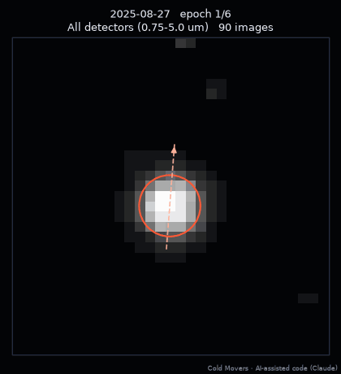
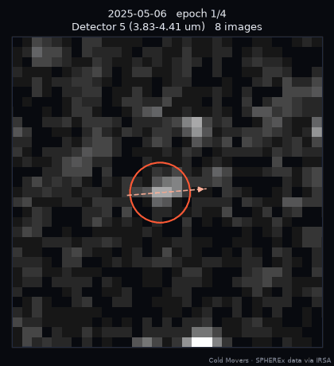
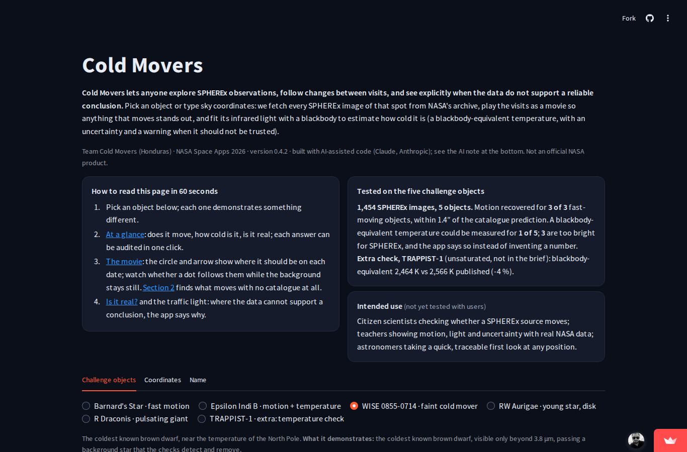

# Cold Movers

**Cold Movers lets anyone explore SPHEREx observations, follow changes between visits, and see explicitly when the data do not support a reliable conclusion.**

NASA Space Apps Challenge 2026 · Challenge: *Planet X and SPHEREx* · Team: Cold Movers (Honduras) · **Live app: https://cold-movers.streamlit.app**

| Barnard's Star crossing the sky, visit by visit | WISE 0855, the coldest known brown dwarf, at 3.8–4.4 µm |
|---|---|
|  |  |
| Measured motion 11.1″ between the first and last SPHEREx visit; the catalogue predicts 11.1″. | Seen only at the longest wavelengths, moving past a background star that the checks detect and remove. |



*Images are real SPHEREx data processed by the app.*

Enter sky coordinates, a star name, or pick one of the five challenge objects. Cold Movers:

1. asks NASA/IPAC IRSA for **every SPHEREx image covering that spot** (Data Release 1 + Quick Release 3),
2. downloads small cutouts, **aligns them on the same patch of sky** and plays them as a **movie, visit by visit**, one per detector, so anything that moves or varies stands out,
3. **follows the object's proper motion** and measures it in every image to build its **0.75–5 µm spectrum**,
4. runs the **Madhava engine**, a band-integrated Planck fit that gives a *blackbody-equivalent temperature* with an uncertainty and a **traffic light** that says how far to trust it,
5. **finds what moves in the field without any catalogue**: every source is followed through the visits and a motion is fitted; a mover is *confirmed* only when two or more detectors agree,
6. runs four **"Is it real?"** consistency checks (indicators, not confirmation of a discovery): seen again in another visit, clean pixels, positions consistent with the catalogue motion, and no blended neighbour,
7. draws a **visual assistant** on the movie: the catalogue prediction, the position measured in each visit with the measured motion vector, a ring coloured by the consistency checks, and the movers found without any catalogue; a **difference view** subtracts the first visit from any later one,
8. explains **what you are looking at in plain words** ("it moved 11.1 arcseconds, about 1.8 pixels"; "it only shows up beyond 3 µm, so it is very cold"; "red light because it saturates the detector"), every sentence written from the measurements on the page.

Every result can be shared as a link (`?object=wise0855` or `?ra=..&dec=..`) and downloaded as CSV or GIF.

In one sentence: **Cold Movers follows and verifies the motion of known objects with SPHEREx's repeated observations, finds movers in a field with no catalogue, and says explicitly when the data cannot support a temperature.** Every measurement links to its original SPHEREx file at NASA/IPAC IRSA (the `url` column of every CSV and the audit trail in the app).

## Validation (results frozen on Nov 14, 2026)

Real SPHEREx DR1 + QR3 data, processed by the app. "Measured near the track" centroids the target close to the catalogue prediction (it tests agreement). "Found with no catalogue" uses no prior position or motion at all.

| Object | SPHEREx images / visits | Moved between first and last visit (measured / catalogue) | Found with no catalogue | Catalogue motion | Blackbody-equivalent temperature | Published |
|---|---|---|---|---|---|---|
| Barnard's Star | 300 / 6 | 11.1″ / 11.1″ | **9.83″/yr towards 354°, confirmed** (detectors 5, 6) | 10.39″/yr, 356° | 🔴 too bright: saturates SPHEREx | 3231 ± 21 K |
| Epsilon Indi B | 299 / 4 | 6.4″ / 6.6″ | **4.54″/yr towards 125°, confirmed** (5 detectors) | 4.68″/yr, 122° | 🟡 1,874 K: not a single blackbody (brown dwarfs have strong molecular bands) | Ba ≈ 1300–1340 K, Bb ≈ 880–940 K |
| WISE 0855−0714 | 256 / 4 | 9.5″ / 8.1″ | 6.36″/yr towards 268°, candidate (detector 5 only) | 8.15″/yr, 275° | 🔴 only seen beyond 3 µm: very cold, range too narrow | ≈ 285 K |
| RW Aurigae | 299 / 3 | 0.5″ / 0.0″ | no mover (correct) | 0.02″/yr | 🔴 saturates beyond 1.1 µm | K-type star with a disk |
| R Draconis | 300 / 3 | 0.4″ / 0.0″ | field not trusted (saturated halo), says so | 0.02″/yr | 🔴 too bright | Mira variable |
| TRAPPIST-1 *(extra)* | 295 / 3 | 1.1″ / 1.0″ | too slow to detect in one year (correct) | 1.05″/yr, 117° | 🟡 **2,464 K (−4 %)**: not a single blackbody | 2566 ± 26 K |

Position angles are east of north. Published temperatures are effective temperatures from detailed models; a blackbody-equivalent temperature is a different quantity, shown next to them for comparison, not as a match. Sources: see [DATA_AND_RESOURCES.md](DATA_AND_RESOURCES.md). These numbers are generated by the app's own code in [docs/validation.md](docs/validation.md).

Software checks: 75 automated tests (series against numerical integration of Planck's law to 1e-8, Madhava's correction term against its guaranteed error bound, synthetic spectra, photometry, proper motion, consistency checks, brightness changes, mover search, visual assistant and plain-language explanations), plus the whole app run headless for every example on each change.

## Why a blink comparator?

In 1930 Clyde Tombaugh found Pluto at Lowell Observatory, during the search for "Planet X", by blinking two photographs of the same sky taken days apart: whatever jumps between them is moving. Cold Movers is a digital blink comparator for SPHEREx. Cold brown dwarfs such as WISE 0855 are invisible to the eye; only infrared light and their motion give them away.

## How it works

| Step | What we do | Why |
|---|---|---|
| Search | IRSA Simple Image Access (collections `spherex_dr1`, `spherex_qr3`); TAP on `spherex.plane` as fallback | Queries the configured collections live, so observations added to them appear without code changes; a new release name is one line (`COLLECTIONS` in `coldmovers/spherex.py`) |
| Cutouts | IRSA cutout service (`?center=RA,DEC&size=DEG`) around the position **propagated to each image's date** | Barnard's Star moves 10.4″/yr: a year-2000 position is 44 SPHEREx pixels off by 2026 |
| Movie | Each cutout is resampled onto one tangent-plane grid with its own WCS; images of the same detector taken during one visit (gap > 20 days) are averaged | SPHEREx's linear variable filters change wavelength across each detector, so raw frames flicker in colour; per-detector visit stacks are stable and make motion visible, in the spirit of WiseView |
| Photometry | 2.5-pixel aperture, background from a 5–9 pixel ring, FLAGS-based pixel rejection, MJy/sr × pixel solid angle → µJy | The wavelength of each measurement comes from the image's own spectral WCS (`WCS-WAVE`) at the target's pixel |
| Madhava engine | Free temperature and scale; each band integrated exactly with the series *F(0→λ) = (15/π⁴) Σ e^(−nx)(x³/n + 3x²/n² + 6x/n³ + 6/n⁴)*, x = hc/λkT; 8 % systematic floor; uncertainty from the χ² profile, inflated when χ²/dof > 1 | SPHEREx bands are wide (R ≈ 35–130); integrating the curve over each band is more faithful than sampling it at the centre |
| Traffic light | 🟢 Planck peak inside SPHEREx coverage (≈580–3860 K) and one blackbody fits; 🟡 measured but not a single blackbody (molecular bands, disk, variability) or peak outside coverage; 🔴 no reliable temperature (too faint, saturated, or edge of range) | The tool says when not to trust it |

"Madhava" is a homage to Madhava of Sangamagrama (c. 1340–1425), a pioneer of infinite series. The series itself is standard physics (Widger & Woodall 1976), not a new result. Like Madhava, who did not simply cut his series for π but added a correction term for the part left out, the engine adds the rest of the series in closed form after N terms. The ratio of consecutive terms grows but stays below e^(−x), which traps the remainder between two limits; the engine adds their midpoint and reports half their width as a guaranteed bound on the series error. With the same number of terms the error is 5 to 40 times smaller than cutting the series, and the app shows the bound under each temperature (for example, below 10⁻¹² for TRAPPIST-1).

## Who it helps

- **Citizen scientists.** Volunteers already find nearby brown dwarfs by blinking WISE images (Backyard Worlds: Planet 9). Cold Movers gives them the same view of SPHEREx, a new and deeper dataset in 102 colours, from any phone or computer, with no installation or account.
- **Students and teachers.** One page shows a star moving across the sky over a single year, its light split into colours, the blackbody-equivalent temperature that light implies and how sure we can be. It turns a NASA archive into a lesson about motion, light and doubt.
- **Astronomers.** A quick first look at any position: is the source there in every visit, does it move as the catalogue says, is a neighbour or a detector artifact contaminating it, and which wavelengths can be trusted. Every number can be downloaded and traced back to its SPHEREx image.

## What we hope to achieve

- Make SPHEREx data **easy to explore for anyone**: the app queries the configured SPHEREx collections live and retrieves whatever observations they hold today; adding a future release is a one-line change.
- Show that a tool can be **honest about its limits**: when SPHEREx saturates, when a neighbour blends in, when one blackbody does not describe the light, the app says so instead of inventing a number.
- Next steps after the hackathon: point-spread-function photometry for crowded fields, a batch mode that checks a whole list of candidates, combining all six detectors in the catalogue-free motion fit to reach fainter movers, and a Spanish version of the interface.

## Tools we used

- **Language:** Python 3.12.
- **Libraries:** Astropy (WCS, FITS, time), Astroquery and PyVO (IRSA, Gaia and SIMBAD access), NumPy and SciPy (fits, resampling), Matplotlib and Pillow (movie frames, GIF), Plotly (interactive spectrum and light curve), Streamlit (web app).
- **Data:** SPHEREx DR1 and QR3 spectral images (NASA/IPAC IRSA), Gaia DR3 (ESA), SIMBAD and Sesame (CDS).
- **Infrastructure:** GitHub (code), GitHub Actions (tests, precomputing the five challenge objects, keeping the app awake), Streamlit Community Cloud (public hosting).
- **Hardware:** none beyond an ordinary laptop; all heavy work runs in the cloud.

## Honest limits

- **Blackbody-equivalent is not effective temperature.** Brown dwarfs have deep water and methane bands; a single Planck curve does not describe them, and the traffic light turns yellow. We show the published temperature next to ours.
- **Very bright stars saturate SPHEREx.** Barnard's Star overflows the detector in every image: its motion is visible in the movie, but its brightness cannot be measured, and the app says so.
- **Aperture photometry, not PSF fitting.** A constant aperture loss does not change the temperature (free scale), but crowded fields can blend neighbours.
- **Variable objects** (R Draconis, RW Aurigae) change between visits; one fit over all visits mixes epochs.

## Run locally

```bash
pip install -r requirements.txt
streamlit run app.py
```

The five challenge objects are precomputed by GitHub Actions (`.github/workflows/precompute.yml`, `scripts/precompute.py`) so the public demo loads instantly; any other position is processed live.

## Tests

```bash
pip install pytest
python -m pytest -q
```

Tests check the series against numerical integration of Planck's law (to 1e-8), the classic 25 % of energy below the Wien peak, recovery of known temperatures from synthetic spectra, the traffic light, aperture photometry, proper-motion propagation, the "Is it real?" checks, brightness changes and the catalogue-free mover search.

## Data and references

The complete inventory of data, references, software, services and their licences and required acknowledgements is in **[DATA_AND_RESOURCES.md](DATA_AND_RESOURCES.md)**. Summary:


- SPHEREx Data Release 1 spectral images, NASA/IPAC Infrared Science Archive, doi:10.26131/IRSA678; SPHEREx Quick Release 3.
- *The SPHEREx image and spectrophotometry processing pipeline*, ApJS 285, 67 (2026), doi:10.3847/1538-4365/ae8843, arXiv:2511.15823.
- IRSA tutorials (BSD-3): "Introduction to SPHEREx Spectral Images", "Download a collection of SPHEREx Spectral Image cutouts".
- Widger, W. K. & Woodall, M. P. 1976, *Integration of the Planck blackbody radiation function*, Bull. Amer. Meteor. Soc. 57, 1217.
- SIMBAD astronomical database and Sesame name resolver (CDS, Strasbourg) for positions, proper motions and parallaxes; Gaia DR3 (Gaia Collaboration, Vallenari et al. 2023, A&A 674, A1) through SIMBAD.
- Published temperatures for comparison: Jahandar et al. 2024 (Barnard's Star, arXiv:2310.12125); King et al. 2010 (ε Indi Ba/Bb, arXiv:0911.3143); Luhman et al. 2024 (WISE 0855−0714, arXiv:2311.17316); Rodriguez et al. 2013 (RW Aur disk, arXiv:1308.2017).
- Inspiration for the movie view: WiseView (Caselden et al. 2018), used by the Backyard Worlds: Planet 9 citizen-science project.
- Software: Astropy, Astroquery, PyVO, NumPy, SciPy, Matplotlib, Pillow, Plotly, Streamlit.

This publication makes use of data products from the Spectro-Photometer for the History of the Universe, Epoch of Reionization and Ices Explorer (SPHEREx), which is a joint project of the Jet Propulsion Laboratory and the California Institute of Technology, and is funded by the National Aeronautics and Space Administration.

Not an official NASA product.

## AI use

We used Claude (Anthropic), an AI coding assistant, to accelerate coding and documentation. The team (Wilmer Espinoza, Miguel Eduardo Romero Sánchez) chose the challenge, the idea and the scientific approach: a modern blink comparator for SPHEREx; the Madhava engine, which fits temperatures with an exact series for the blackbody light in each band and adds Madhava's correction term with a guaranteed error bound; and an honest traffic light that says when a result cannot be trusted. We decided every feature and which objects to test, and we reviewed the code.

All AI-generated code was reviewed and tested by the team and refined from our feedback before it went into the app. We checked every result against published temperatures and catalogue motions, and independent reviewers reported bugs that we fixed. Automated tests and a full headless run of the app check every change. Commits made with the assistant carry a `Co-Authored-By: Claude` line. No NASA branding is used.

## License

MIT, see [LICENSE](LICENSE).
